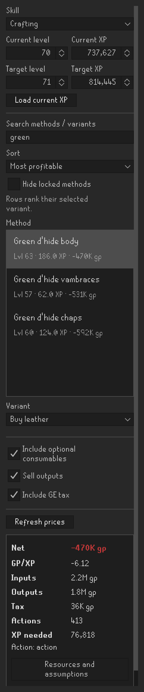
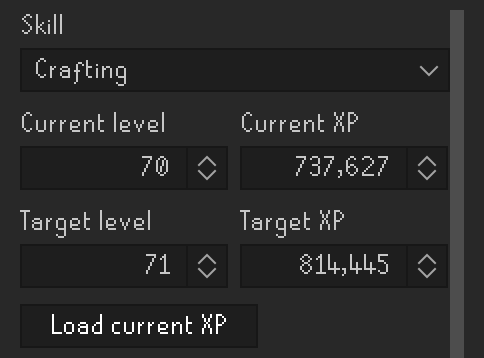
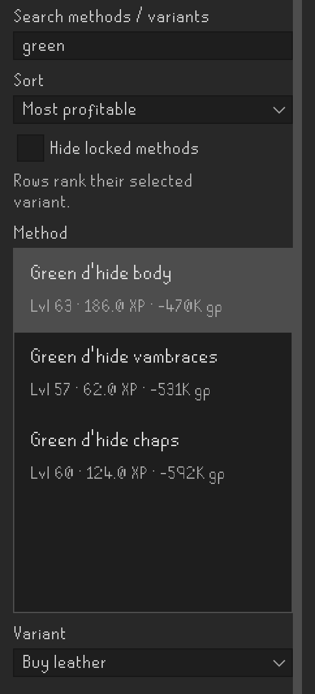
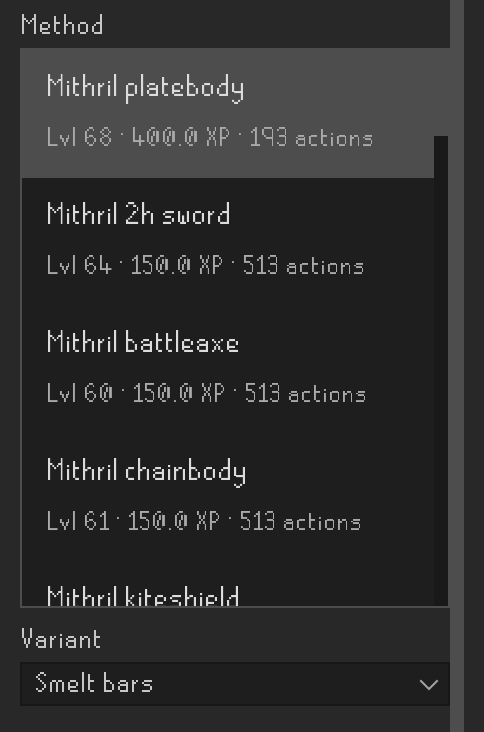
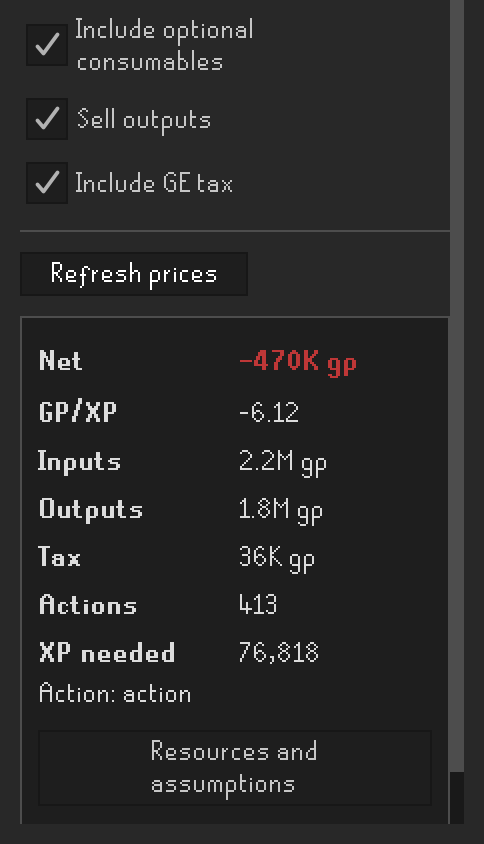
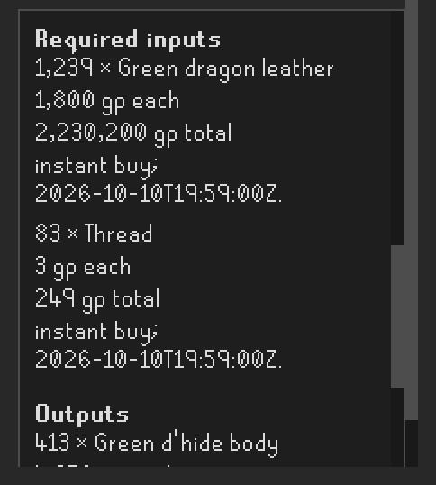
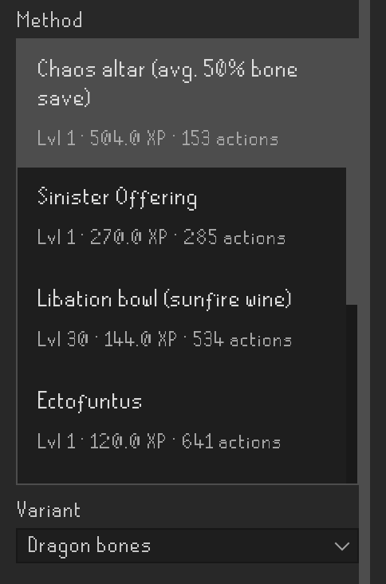
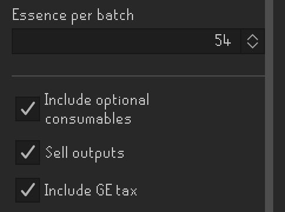

# Skilling Cost Calculator

A RuneLite plugin for estimating the cost, profit or loss of a skilling goal.
It calculates the supplies you need and how much you can recoup by selling the
items you make, using OSRS Wiki GE prices.

The catalog includes **909 methods across 11 skills**, with production variants,
Prayer offerings and newer skilling methods.

**Wiki prices** are enabled by default to fetch GE quotes. You can turn them off
in the plugin configuration; an existing saved preference takes priority.

*Screenshots show the current panel with example XP and prices. Your estimates
will use your chosen goal and the available GE quotes.*

## Current scope

- Reads your current level/XP when you choose a skill, with manual entry available.
- Lets you choose a target level or XP. The first goal is your next level.
- Remembers each skill's target, search and selected method/variant while the
  panel is open. **Load current XP** updates your starting point while preserving
  an explicit target.

- Search for methods or variants, and optionally **Hide locked methods**.
- Sort by **Least actions** or **Most profitable**. Profitable sorting also shows
  the estimated net GP for each row's selected variant.
- Scroll through the method list; methods above your current level have their
  level/XP line highlighted in red.

- Choose production variants such as buying Smithing bars or smelting them first.
  The XP, supplies and estimate update for the chosen variant.

- Changing a goal, method or option automatically updates the estimate.
- **Include optional consumables**, **Sell outputs** and **Include GE tax** are
  global toggles. They stay clickable and keep your choices across methods and
  skills. Each recipe applies the relevant options; tax applies when outputs
  are sold.
- Shows net GP, GP/XP, input/output values, tax, actions and XP needed.
- **Refresh prices** fetches new quotes. Other edits reuse recent prices.

- Expand **Resources and assumptions** for exact quantities, prices, fees and
  requirements. Scroll through the details to see inputs, outputs and assumptions.
- Fixed fees and collected untradeable supplies are listed explicitly. Missing
  required quotes make an estimate unavailable.
- Supports prices above the old integer limit, including trillion GP values.
  Large totals use compact formatting; resource details retain exact amounts.

- For Prayer, choose the offering method first, then the bone or ash variant.
- Includes burying/scattering, altars, Ectofuntus, bone shards and offering spells.
  Chaos altar estimates use the average 50% bone save.

- Combination-rune recipes expose **Essence per batch**. Set it to the number you
  process in one altar interaction, including your pouch setup.
- Partial batches include the recipe's talisman or imbue use and binding-necklace
  charge. Level-dependent yields use your starting level throughout the estimate.

## Notes

Estimates use the assumptions listed for each method. Cooking assumes no burns,
wine assumes success, and chaos altar saves are an average. Equipment, quests,
travel and incidental costs are explained in **Resources and assumptions**.

Fallback, stale and unknown-age quotes are identified. If a refresh fails, any
retained estimate is labelled as using the previous snapshot and inputs.

See [catalog coverage and sources](docs/CATALOG_COVERAGE.md) and
[price behavior](docs/PRICING.md) for more detail.

## Development

See [docs/DEVELOPMENT.md](docs/DEVELOPMENT.md) for the code layout, local setup and
verification, and [the method schema](docs/METHOD_SCHEMA.md) for recipe data.

## Credits

GPT was used to help create this plugin and its documentation.

The icon art was drawn by a wonderful artist named Nikki (I told her to make it a little janky)
